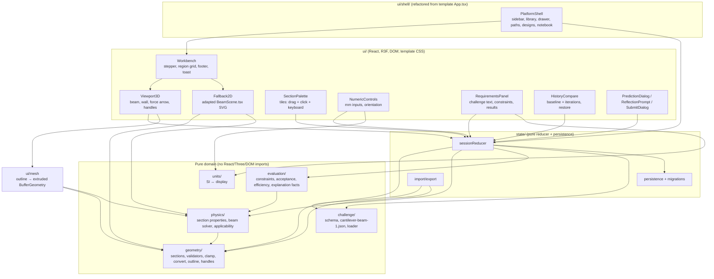
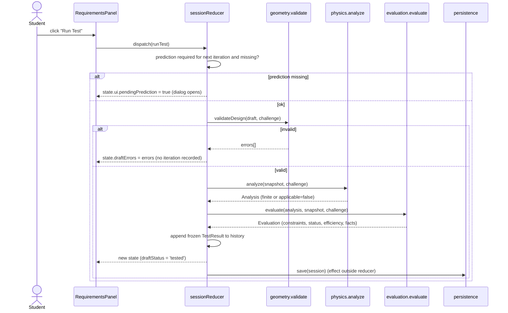
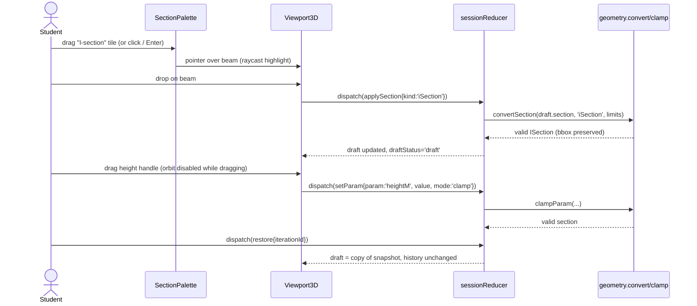

# Design Document: Statica MVP (Cantilever Beam I)

## Overview

Statica (working title "Engineering Intuition Platform") is a browser-only single-page application that trains students to diagnose and improve an existing, flawed mechanical component. The MVP ships one polished challenge, "Cantilever Beam I: Reduce Deflection". A student inspects a cantilever with a downward tip load, predicts the effect of a change, swaps and resizes the cross-section in a 3D viewport (drag/drop, dimension handles, or numeric/keyboard input), runs a deterministic Euler-Bernoulli analysis, reads per-constraint pass/fail feedback, compares iterations, restores earlier designs, answers a reflection prompt, and submits.

The design keeps a strict boundary between pure, deterministic domain code (`units/`, `challenge/`, `geometry/`, `physics/`, `evaluation/`, `state/`) and the presentation layer (`ui/`). Every numeric result comes from typed section parameters through pure functions. Nothing is ever computed from meshes, rendering state, or an LLM. Guided and Parametric modes share one typed `BeamDesign` representation and one solver; they differ only in presentation, and neither unlocks locked fields.

The MVP is built inside the user's Figma Make template at `Educational Tool UI Design/` (the project root). The template's stack (React 19, Vite 8, Tailwind CSS v4, TypeScript 5.7 strict, pnpm 10 on Node 22, Figma Make Vite plugins), its CSS and visual design, and its platform shell (sidebar, challenge library, detail drawer, learning paths, my designs, notebook, mode cards, workflow stepper) are kept. The template's prototype physics (`src/physics.ts`) is removed and replaced by the domain modules, and its monolithic `Workspace.tsx` is refactored into the `ui/` components below without changing the look. Challenges other than Cantilever Beam I, and the Freeform mode, stay labeled previews that never run analysis.

Scope covers Milestones 0–3 (template adaptation/CI, physics/constraints, 3D interaction, learning loop). Milestone 4 (student pilot), Milestone 5 (second runnable challenge as config), and Milestone 6+ (Freeform mode, advanced physics, accounts, AI) are out of scope for implementation. The design only leaves extension points for them: config-driven challenges, an `InteractionMode` enum, and a `modelId` field on analyses.

### Recorded decisions (seed for `DECISIONS.md`)

| ID | Decision | Source |
|----|----------|--------|
| D-01 | Stack: TypeScript 5.7 (strict), React 19 + Vite 8 (from the template, see D-18), Three.js via React Three Fiber (+ drei helpers), Vitest, fast-check, Testing Library, Playwright. | Spec §6, template |
| D-02 | No live numeric previews before Run Test. Geometry (shape, outline, dimensions in mm, envelope box) previews live; area/I/mass/deflection/stress appear only in tested results. | Open decision default |
| D-03 | Orientation limited to 0° / 90°. | Open decision default |
| D-04 | Persistence: `localStorage` with `schemaVersion` and a migration table; corrupt or unknown data is discarded with a notice and never partially applied. | Open decision default |
| D-05 | The baseline design is auto-analyzed and stored as iteration 0 ("Baseline"), so the student can see the starting problem quantitatively and compare against it. | Interpretation of §3/§4 |
| D-06 | Handle drags clamp to the permissible range. Numeric inputs reject out-of-range or non-finite input with a reason and leave the draft unchanged. | §4, §7 |
| D-07 | Parameter ranges go up to 100 mm, so the 80 × 80 mm envelope is a real, failable constraint. Minimum feature sizes are lower bounds of the ranges and are re-checked at test time (covers imported JSON). | §4 |
| D-08 | Invalid geometry blocks Run Test (no iteration recorded). Out-of-assumption geometry is analyzed but gets status `modelNotApplicable`, never Accepted. | §5 |
| D-09 | Hard-limit comparison is inclusive with relative tolerance `REL_TOL = 1e-9`: pass iff `value ≤ limit·(1 + REL_TOL)`. | §4 |
| D-10 | Prediction is required before iterations 1 and 3 (config `predictionPolicy.requiredOnIterations`) and optional otherwise. It is compared against the previous tested iteration, and "same" means a relative change of 2% or less. | §4 |
| D-11 | Deformation exaggeration is a fixed factor per challenge (`k = 0.1·L / δ_allow` = 15×), clamped to 0.3·L, so visual comparisons across iterations are consistent. The label reads "Exaggerated visualization (×15)". | §4 |
| D-12 | Switching section type preserves the current outer bounding box (clamped to the new type's ranges). Thicknesses start at the challenge defaults. | Design choice |
| D-13 | Validation: zod schemas are the source of truth, and a committed `challenge.schema.json` is generated from them. | §6, §9 M0 |
| D-14 | Submission targets a student-selected tested iteration (default: latest). It requires at least one non-baseline test and a non-empty reflection answer. Reflection text is recorded, not graded. | §4 |
| D-15 | Branding: product name "Statica" (user-selected, from the template's DECISIONS.md). "Engineering Intuition" remains the internal working title; storage keys and the export `format` keep the `ei` prefix. | Template DECISIONS.md |
| D-16 | Dependencies are pinned to exact versions at M0 (template caret ranges converted). No backend and no network calls at runtime, so the app works offline after install/build. | §6, §9 |
| D-17 | Project root is the template folder `Educational Tool UI Design/`. All source, config, CI, and docs live there; no new scaffold is generated. | User plan |
| D-18 | Keep the template stack: React 19, Vite 8, Tailwind CSS v4 via `@tailwindcss/vite`, TypeScript 5.7 strict, pnpm 10 / Node 22 (per `.mise.toml`), oxfmt, the `@` alias, and the four Figma Make Vite plugins. pnpm replaces npm everywhere (`pnpm install --frozen-lockfile`, `pnpm-lock.yaml`). | User plan |
| D-19 | Keep the template's visual design and platform shell (sidebar, library with filters/search/saved, detail drawer, learning paths, my designs, notebook, mode cards, workflow stepper, `Icon`, `SectionIcon`, `TechnicalArt`, and the three stylesheets). Workspace regions map onto spec components (see the UI table). | User plan |
| D-20 | Only Cantilever Beam I is runnable. Other challenges, learning-path steps, and Freeform mode stay labeled previews/"Planned" and never run or display fabricated analysis. Guided and Parametric are both runnable (`allowedModes: ['guided','parametric']`), share one `BeamDesign` and solver, and differ only in presentation. Difficulty is independent of mode. | Template DECISIONS.md, user plan |
| D-21 | Fonts: DM Sans and Manrope are self-hosted via exactly pinned `@fontsource/dm-sans` and `@fontsource/manrope` imports in `index.css` (weights used by the CSS only), replacing the Google Fonts `@import`, so the app makes zero third-party requests. | Requirement 1.11, 1.13 |
| D-22 | Main viewport is React Three Fiber/WebGL, styled to the template palette. The template's SVG `BeamScene.tsx` projection is kept as the WebGL fallback (`Fallback2D`), adapted to read the typed `Section`, orientation, and `deflectionShape` instead of its hard-coded curve. | User plan, Requirement 31 |
| D-23 | The template's `src/physics.ts` and `node:test` suite are deleted, not adapted. Its divergences from this spec are removed: shared web/flange thickness (spec: independent tf and tw), applicability thresholds span/depth ≥ 10 and δ/L ≤ 1/20 (spec: the 14 thresholds in `physics/constants.ts`), no REL_TOL, the 40×50×3 reference design (spec: h60/b40/tf4/tw3), the 80 mm max folded into geometry validation (spec: 100 mm ranges, 80 mm is an envelope constraint), and always-true envelope/min-feature checks (spec: evaluated constraints). | User plan |
| D-24 | CSP `default-src 'self'` is injected by a production-only Vite plugin ordered after the Figma plugins. To stay compatible: `site.json` keeps no analytics ID, no custom scripts, and `addBypassLinks` false (it injects an inline `<style>`); `build.assetsInlineLimit = 0` (no `data:` URLs); the dev-only Figma plugins (`apply: 'serve'`) never reach production output; drei helpers that fetch remote assets (`Environment` presets, remote `Text` fonts) are not used. | Requirement 23.8, 23.9 |

### Template DECISIONS.md merge (seed for task 1.7)

The template's `DECISIONS.md` is merged into the spec `DECISIONS.md` under a "Template decisions" heading, each entry marked:

| Template decision | Disposition |
|-------------------|-------------|
| Platform shell separated from the active workspace; workbench stays mounted across navigation | Retained (D-19, Requirement 34.6) |
| Challenge metadata: discipline, difficulty, concepts, availability, visual family; difficulty independent of mode | Retained (D-19, D-20) |
| Guided and Parametric use the same beam representation; neither unlocks fixed parameters; Freeform and other solvers are labeled previews | Retained (D-20) |
| Learning paths are previews; library saving and notebook are session-local | Retained (Requirement 34.5, 34.8) |
| "Reload persistence and durable storage remain outstanding" | Superseded by D-04 (`localStorage` session persistence) |
| Statica is the product name | Retained (D-15) |
| Deterministic SI analysis, mm display | Retained (D-02, Requirement 2) |
| Dependency-free SVG projection, not WebGL | Superseded by D-22 (R3F main view; SVG kept as fallback) |
| Applicability: span/depth ≥ 10, δ/span ≤ 1/20 | Superseded by D-23 and the threshold table |
| Shared I-section web/flange thickness; no drag handles | Superseded by D-23 (independent tf/tw) and Requirement 27 (handles) |
| In-memory history, JSON export of runs, no reload persistence | Superseded by D-04 and Requirement 22 (`ei-design` export format) |
| Unmodeled effects listed; no certification implied | Retained, extended by `unsupportedEffects` (Requirement 10.9) |
| Tests use Node's built-in runner against the physics module | Superseded by D-01 (Vitest, fast-check, Playwright) |

### Findings in `.figma/make/site.json`

The file sets `description`, `robots.index: false`, and `accessibility: { addBypassLinks: false, ignoreReducedMotion: false }`. It sets no `analytics.googleAnalyticsId` and no `customScripts`, so nothing has to be removed today. Requirement 23.9 still adds a guard test so neither can be introduced later, and keeps `addBypassLinks` false because the plugin would inject an inline `<style>` that `default-src 'self'` blocks. `robots.index: false` emits a `noindex` meta tag and a `robots.txt` asset, both CSP-neutral. No `title` is set, so the plugin falls back to "Figma Make App"; task 1.5 sets `"title": "Statica"`.

## Architecture



Dependency rule (enforced by ESLint `no-restricted-imports` plus an architecture unit test): `units`, `challenge`, `geometry`, `physics`, and `evaluation` must not import `react`, `three`, `@react-three/*`, `ui/`, or `state/`. `physics` must not import `evaluation`. `ui/mesh` and `ui/viewport/Fallback2D` may read `physics.deflectionShape` and `geometry.sectionOutline` for visualization only, and their output never flows back into results. Platform shell pages (`ui/shell/`) hold no physics: the only numbers they show come from session Test_Results or static challenge metadata (title, time estimate). An architecture test fails if `src/physics.ts` reappears or if any `ui/` file contains the section formulas (Requirement 1.14).

### Folder layout (project root = `Educational Tool UI Design/`)

Legend: **[kept]** retained unchanged, **[edit]** retained and modified, **[refactor]** split into the listed files, **[delete]** removed, **[new]** added.

```
Educational Tool UI Design/
├─ .figma/make/                    [kept] Figma Make scripts; site.json [edit] adds "title": "Statica"
├─ .mise.toml                      [kept] node 22, pnpm 10.34.3
├─ .github/workflows/ci.yml        [new]  pnpm install --frozen-lockfile, lint, typecheck, test, build, schema drift, e2e
├─ AGENTS.md  CLAUDE.md            [edit] add test/lint commands and the domain boundary rule
├─ DECISIONS.md                    [edit] merged: D-01…D-24 + template decisions with dispositions
├─ README.md                       [new]
├─ index.html                      [kept] Figma comment slots; CSP meta injected at build
├─ package.json                    [edit] exact pins, new deps, scripts dev/lint/typecheck/test/build/e2e/gen:schema/format
├─ pnpm-lock.yaml                  [edit] regenerated by pnpm 10
├─ tsconfig.json                   [edit] include test/, e2e/, scripts/; strict kept
├─ vite.config.ts                  [edit] Figma plugins kept; add CSP plugin (build only), assetsInlineLimit 0
├─ vitest.config.ts  playwright.config.ts  eslint.config.js   [new]
├─ public/favicon.svg              [kept]
├─ schemas/challenge.schema.json   [new]  generated (pnpm run gen:schema)
├─ scripts/gen-schema.ts           [new]
├─ src/
│  ├─ main.tsx                     [edit] mounts ui/App
│  ├─ index.css                    [edit] Google Fonts @import → @fontsource imports; focus-ring/contrast tokens
│  ├─ platform.css  platform-base.css   [kept]
│  ├─ App.tsx                      [refactor] → ui/App.tsx + ui/shell/*
│  ├─ Workspace.tsx                [refactor] → ui/workbench/*, ui/palette, ui/controls, ui/panels, ui/history, ui/dialogs, ui/icons
│  ├─ BeamScene.tsx                [refactor] → ui/viewport/Fallback2D.tsx (+ ui/viewport/projection.ts)
│  ├─ TechnicalArt.tsx             [kept, moved] → ui/shell/TechnicalArt.tsx
│  ├─ physics.ts  physics.test.ts  [delete] replaced by domain modules
│  ├─ units/          units.ts                                                    [new]
│  ├─ challenge/      types.ts schema.ts loader.ts challenges/cantilever-beam-1.json content.ts catalog.ts [new]
│  ├─ geometry/       sections.ts validate.ts clamp.ts convert.ts outline.ts handles.ts envelope.ts [new]
│  ├─ physics/        sectionProperties.ts beam.ts applicability.ts constants.ts tolerance.ts analyze.ts [new]
│  ├─ evaluation/     types.ts constraints.ts acceptance.ts efficiency.ts explain.ts prediction.ts [new]
│  ├─ state/          session.ts reducer.ts selectors.ts persistence.ts migrations.ts importExport.ts [new]
│  └─ ui/             App.tsx state/ shell/ workbench/ viewport/ palette/ controls/ panels/ history/ dialogs/ mesh/ a11y/ icons/ [new]
├─ test/              pbt.ts arbitraries.ts architecture.test.ts siteConfig.test.ts fixtures/designs.ts state/model.ts [new]
└─ e2e/               happy-path drag-drop keyboard invalid-path persistence platform .spec.ts, helpers.ts [new]
```

`challenge/catalog.ts` holds the static preview metadata for the shell (title, discipline, difficulty, time, concepts, art kind, `available`) moved from the template's `App.tsx`. Only `cantilever-beam-1` has `available: true` and a loadable challenge JSON; previews carry no physics data.

## Sequence Diagrams

### Run Test flow



### Edit, drag-and-drop, and restore




## Coordinate and Axis Convention (single source of truth)

- Global scene: **X** is longitudinal (root at x = 0 on the wall, free end at x = L). **Y** is vertical, and the load acts in −Y. **Z** is horizontal (width).
- Section-local axes: **u** is horizontal and carries the width `b`. **v** is vertical and carries the height `h`. At `orientationDeg = 0`, u ≡ global Z and v ≡ global Y.
- `IxxM4` is the second moment about the section's centroidal **u-axis** (horizontal at 0°), which is the property that resists vertical (Y) deflection at 0°. `IyyM4` is the moment about the centroidal **v-axis**. Both are intrinsic to the section and do not depend on orientation.
- Rotating the section 90° about global X maps the section's u-axis onto global Y. As a result:
  - `orientation 0°`: `I_bend = Ixx`, `c = h/2`, occupied width (Z) = `b`, occupied height (Y) = `h`.
  - `orientation 90°`: `I_bend = Iyy`, `c = b/2`, occupied width (Z) = `h`, occupied height (Y) = `b`.
  - Circle/tube: `Ixx = Iyy`, so orientation has no effect. The UI disables the rotate control for these shapes, but the data still holds 0 | 90.
- The viewport shows labels for "Bending axis (resists vertical load)" and the X/Y/Z triad. Tests assert both the swap and the labels.

## Components and Interfaces

All code is TypeScript (spec §6). Lengths are in m, forces in N, stresses in Pa, masses in kg, and angles in degrees as a 0 | 90 enum. Display conversion happens only in `units/`.

### Component: units/

**Purpose**: Convert between SI and display units at the UI boundary only.

```typescript
export const mToMm = (m: number): number => m * 1e3;
export const mmToM = (mm: number): number => mm / 1e3;
export const paToMpa = (pa: number): number => pa / 1e6;
export const m4ToMm4 = (m4: number): number => m4 * 1e12;
export const m2ToMm2 = (m2: number): number => m2 * 1e6;
/** Parses user text in mm. Returns null for empty, non-numeric, or non-finite input. */
export function parseMmInput(text: string): number | null;
/** Fixed-precision display formatting (no locale-dependent separators in tests). */
export function formatMm(m: number, digits?: number): string;
```

### Component: challenge/

**Purpose**: Scenario definitions, immutable load case, editable parameter ranges, limits, content, and the schema-validated loader.

```typescript
export type Difficulty = 'introductory' | 'intermediate' | 'advanced';
export type InteractionMode = 'guided' | 'parametric' | 'freeform';
export type LockedField = 'lengthM' | 'materialId' | 'forceN' | 'support';
export type SectionKind = 'circle' | 'tube' | 'rectangle' | 'iSection';

export interface Material {
  id: string; name: string;
  elasticModulusPa: number; densityKgM3: number;
  allowableStressPa: number;      // educational nominal, not certified
  yieldStressPa: number;          // used only for the applicability (plasticity) screen
}

export interface ParamRange { minM: number; maxM: number; stepM: number }
export interface SectionLimits {
  circle:    { diameterM: ParamRange };
  tube:      { outerDiameterM: ParamRange; minWallM: number };
  rectangle: { widthM: ParamRange; heightM: ParamRange };
  iSection:  { widthM: ParamRange; heightM: ParamRange;
               minFlangeThicknessM: number; minWebThicknessM: number; minClearWebHeightM: number };
}

export interface Challenge {
  id: string; version: number; title: string;
  difficulty: Difficulty;                    // independent of mode
  allowedModes: InteractionMode[];           // MVP: ['guided', 'parametric']; 'freeform' is preview-only
  statement: string;
  material: Material;
  initialDesign: BeamDesign;
  referenceDesign?: BeamDesign;              // test fixture / instructor demo only, never shown to students
  lockedFields: LockedField[];
  support: 'fixedRoot';
  load: { forceN: number; location: 'freeEnd'; direction: 'down' };
  constraints: { maxMassKg: number; maxDeflectionM: number; maxStressPa: number;
                 maxWidthM: number; maxHeightM: number };
  sectionLimits: SectionLimits;
  allowedSections: SectionKind[];
  predictionPolicy: { requiredOnIterations: number[] };   // 1-based, non-baseline
  reflectionPrompt: { id: string; text: string };
  visualization: { exaggerationFactor: number; maxVisualDeflectionFractionOfL: number };
  content: { conceptNotes: Record<string, string>; collegeDetails: boolean };
}

/** Validates unknown JSON against the zod schema and cross-field rules (see validateChallenge). */
export function loadChallenge(json: unknown): Result<Challenge, SchemaIssue[]>;
```

**Responsibilities**: Challenge data is frozen with `deepFreeze` after load. Difficulty and mode are separate fields, and no code branches on one to decide the other. Locked fields cannot be changed by any reducer action, and the reducer ignores any attempt to change them (tested).

### Component: geometry/

**Purpose**: Section types, validation, clamping, type conversion, oriented envelope, outline points for mesh generation, and handle descriptors.

```typescript
export type Section =
  | { kind: 'circle'; diameterM: number }
  | { kind: 'tube'; outerDiameterM: number; innerDiameterM: number }
  | { kind: 'rectangle'; widthM: number; heightM: number }
  | { kind: 'iSection'; widthM: number; heightM: number; flangeThicknessM: number; webThicknessM: number };

export type Orientation = 0 | 90;
export interface BeamDesign {
  id: string; section: Section; orientationDeg: Orientation;
  lengthM: number; materialId: string;
}

export type GeometryErrorCode =
  | 'NON_FINITE' | 'NON_POSITIVE' | 'BELOW_MIN' | 'ABOVE_MAX'
  | 'INNER_NOT_LESS_THAN_OUTER' | 'WALL_TOO_THIN'
  | 'FLANGES_OVERLAP' | 'WEB_WIDER_THAN_FLANGE' | 'FLANGE_TOO_THIN' | 'WEB_TOO_THIN'
  | 'SECTION_NOT_ALLOWED' | 'LOCKED_FIELD_CHANGED' | 'BAD_ORIENTATION';
export interface GeometryError { code: GeometryErrorCode; param?: string; message: string }

export function validateSection(s: Section, limits: SectionLimits): GeometryError[];
export function validateDesign(d: BeamDesign, ch: Challenge): GeometryError[];
export function clampParam(s: Section, param: string, valueM: number, limits: SectionLimits): Section;
export function trySetParam(s: Section, param: string, valueM: number, limits: SectionLimits):
  Result<Section, GeometryError[]>;
export function convertSection(from: Section, to: SectionKind, limits: SectionLimits,
  defaults: SectionDefaults): Section;
export function sectionBoundingBox(s: Section): { widthM: number; heightM: number }; // unrotated (u, v)
export function orientedEnvelope(s: Section, o: Orientation): { widthZM: number; heightYM: number };
export function sectionOutline(s: Section, segments?: number): { outer: Vec2[]; holes: Vec2[][] };
export function handlesFor(s: Section, o: Orientation): HandleDescriptor[];
export interface HandleDescriptor { param: string; axis: 'Y' | 'Z'; anchorM: Vec2; label: string; range: ParamRange }
```

**Responsibilities**: Geometry is valid by construction after `clampParam` and `convertSection`. `validateDesign` is re-run at Run Test and on import, because imported or persisted data is untrusted. Outlines are display-only.

### Component: physics/

**Purpose**: Pure deterministic section properties, beam solver, and applicability. It imports only `geometry/` types and `physics/constants`.

```typescript
export interface SectionProperties { areaM2: number; IxxM4: number; IyyM4: number;
  cVerticalM: number /* h/2 */; cHorizontalM: number /* b/2 */ }

export type ModelId = 'eulerBernoulliCantileverTipForce';
export interface Analysis {
  modelId: ModelId;
  applicable: boolean;
  warnings: ApplicabilityIssue[];       // applicable but approaching limits
  notApplicableReasons: ApplicabilityIssue[];
  unsupportedEffects: string[];         // always-listed effects not modeled
  assumptions: string[];
  areaM2: number; IxxM4: number; IyyM4: number;
  bendingInertiaM4: number; extremeFiberM: number;
  massKg: number; tipDeflectionM: number; maxMomentNm: number; nominalMaxStressPa: number;
}
export interface ApplicabilityIssue { code: ApplicabilityCode; message: string; value: number; threshold: number }

export function sectionProperties(s: Section): SectionProperties;
export function bendingProperties(p: SectionProperties, o: Orientation): { I: number; c: number };
export function tipDeflection(F: number, L: number, E: number, I: number): number;
export function maxMoment(F: number, L: number): number;
export function nominalStress(M: number, c: number, I: number): number;
export function deflectionShape(F: number, L: number, E: number, I: number, x: number): number;
export function checkApplicability(d: BeamDesign, a: Omit<Analysis, 'applicable'|'warnings'|'notApplicableReasons'>,
  ch: Challenge): { warnings: ApplicabilityIssue[]; notApplicable: ApplicabilityIssue[] };
/** Precondition: validateDesign(d, ch) is empty. Never returns NaN/Infinity; throws PhysicsInvariantError otherwise. */
export function analyze(d: BeamDesign, ch: Challenge): Analysis;
```

### Component: evaluation/

**Purpose**: Constraint checks, acceptance status, efficiency indicators, prediction scoring, and explanation facts that are grounded only in numeric results.

```typescript
export type ConstraintId = 'deflection' | 'stress' | 'mass' | 'envelopeWidth' | 'envelopeHeight'
                         | 'featureGeometry' | 'applicability';
export interface ConstraintResult { id: ConstraintId; label: string; value: number; limit: number;
  unit: 'm' | 'Pa' | 'kg' | 'bool'; passed: boolean; utilization: number /* value/limit */ }
export type EvaluationStatus = 'accepted' | 'notAccepted' | 'modelNotApplicable';
export interface Evaluation {
  status: EvaluationStatus; accepted: boolean;
  constraints: ConstraintResult[]; failures: ConstraintId[];
  efficiency: { massUsage: number; deflectionMargin: number; stressMargin: number };
  facts: ExplanationFact[];
}
export interface ExplanationFact { id: string; text: string; basis: Record<string, number> }

export const REL_TOL = 1e-9;
export function withinLimit(value: number, limit: number, relTol?: number): boolean;
export function evaluate(d: BeamDesign, a: Analysis, ch: Challenge): Evaluation;
export function compareResults(prev: TestResult, next: TestResult): ComparisonDelta;
export function explainChange(prev: TestResult, next: TestResult): ExplanationFact[];
export function scorePrediction(p: Prediction, prev: TestResult, next: TestResult): PredictionOutcome;
```

### Component: state/

**Purpose**: Session model, pure reducer, selectors, persistence, migrations, and import/export.

```typescript
export type DraftStatus = 'draft' | 'tested';   // 'tested' iff draft deep-equals the latest snapshot
export type PredictionDirection = 'increase' | 'decrease' | 'same';
export interface Prediction { iteration: number; direction: PredictionDirection; explanation?: string; createdAt: string }
export interface TestResult {
  id: string; iteration: number;                // 0 = baseline
  designSnapshot: Readonly<BeamDesign>; analysis: Readonly<Analysis>; evaluation: Readonly<Evaluation>;
  accepted: boolean; failures: ConstraintId[];
  prediction?: Prediction; predictionOutcome?: PredictionOutcome;
  timestamp: string;
}
export interface Submission { testResultId: string; status: EvaluationStatus; reflection: string;
  efficiency: Evaluation['efficiency']; submittedAt: string }
export interface SessionState {
  schemaVersion: 1; challengeId: string; challengeVersion: number;
  mode: InteractionMode;
  draft: BeamDesign; draftStatus: DraftStatus; draftErrors: GeometryError[];
  history: ReadonlyArray<TestResult>;           // append-only
  pendingPrediction?: Prediction;
  compareSelection: string[];                   // TestResult ids, baseline always available
  reflectionAnswer: string;
  submission?: Submission;
  ui: { predictionDialogOpen: boolean; notice?: Notice };
}

export type Action =
  | { type: 'applySection'; kind: SectionKind }
  | { type: 'setParam'; param: string; valueM: number; mode: 'clamp' | 'strict' }
  | { type: 'setOrientation'; orientationDeg: Orientation }
  | { type: 'setPrediction'; direction: PredictionDirection; explanation?: string }
  | { type: 'cancelPrediction' }                    // closes the dialog, stores nothing (Requirement 14.5)
  | { type: 'runTest'; now: string; id: string }   // time and id are injected for determinism
  | { type: 'restore'; testResultId: string }
  | { type: 'toggleCompare'; testResultId: string }
  | { type: 'setReflection'; text: string }
  | { type: 'submit'; testResultId: string; now: string }
  | { type: 'importDesign'; json: unknown }
  | { type: 'reset' };

export function initSession(ch: Challenge, now: string, id: string): SessionState; // includes baseline iteration 0
export function sessionReducer(s: SessionState, a: Action, ch: Challenge): SessionState;
export function serializeSession(s: SessionState): string;
export function deserializeSession(raw: string, ch: Challenge): Result<SessionState, string>;
export function exportDesign(d: BeamDesign, ch: Challenge): string;   // {format:'ei-design', schemaVersion:1, challengeId, design}
export function importDesign(json: unknown, ch: Challenge): Result<BeamDesign, string[]>;
```

### Component: ui/

**Purpose**: Presentation only. UI components dispatch actions and render selectors. They never compute physics outside `physics/`.

Template region → spec component mapping (class names kept so the template CSS applies unchanged):

| Template region (`Workspace.tsx`) | Spec component(s) | Source |
|-----------------------------------|-------------------|--------|
| `aside.sidebar`, `header.topbar`, `.page-heading`, `.workspace-context` | `ui/workbench/WorkbenchChrome.tsx` | refactor |
| `.workflow` stepper | `ui/workbench/WorkflowStepper.tsx` (state from selectors) | refactor |
| `section.design-panel` | `SectionPalette` + `NumericControls` (+ locked fields block) | refactor |
| `section.viewport` (+ `.scene-controls`, `.viewport-bottom`, `.material-strip`, `.fixed-label`) | `ViewportBoundary` → lazy `Viewport3D` or `Fallback2D`; `ui/viewport/SceneControls.tsx` | replace scene, keep chrome |
| `aside.challenge-panel` | `RequirementsPanel` (Run Test in `.test-action`) | refactor |
| `section.results-panel` (tabs "Design history" / "Compare results") | `HistoryCompare` (+ `ImportExportBar` in `.history-note`) | refactor |
| `footer.page-footer` | `ui/workbench/PageFooter.tsx`: model-limits notice + "Explain & submit" | refactor |
| `.modal-backdrop .modal` (predict / submit / help) | `Dialog` primitive → `PredictionDialog`, `SubmitDialog` (+ `ReflectionPrompt`), `HelpDialog`, import error dialog | refactor |
| `.toast` | `ui/a11y/Toast.tsx` (visual notice) + separate always-present `LiveRegion` | refactor |
| `Icon`, `SectionIcon` | `ui/icons/Icon.tsx`, `ui/icons/SectionIcon.tsx` | kept, moved |
| `App.tsx` platform pages | `ui/shell/PlatformShell.tsx`, `LibraryPage`, `ChallengeDrawer`, `LearningPathsPage`, `MyDesignsPage`, `NotebookPage`, `ResourceDialog` | refactor |
| `TechnicalArt.tsx` | `ui/shell/TechnicalArt.tsx` | kept, moved |
| `BeamScene.tsx` | `ui/viewport/Fallback2D.tsx` + pure `ui/viewport/projection.ts` | refactor (reads typed Section) |
| `physics.ts`, `physics.test.ts` | domain modules + Vitest suites | delete |

| Component | Responsibilities |
|-----------|-----------------|
| `PlatformShell` | Template sidebar, library (discipline/difficulty filters, search, Explore/Saved), detail drawer with mode cards (Guided, Parametric available; Freeform "Planned", open disabled), learning paths (non-first steps "Planned"), my designs (lists session Test_Results only), notebook (session-local), help/resources. Keeps the Workbench mounted while navigating so session state survives (Requirement 34). Preview challenges show "Not available yet" and never open a Workbench. |
| `Workbench` / `AppLayout` | Template `.workbench` grid: `design-panel` (left), viewport (center), `challenge-panel` (right), `results-panel` full width below, `page-footer`. Breakpoints come from `index.css`: > 1250 / ≤ 1250 / ≤ 1050 (collapsed 72 px sidebar) / ≤ 870 (two columns, challenge panel spans) / ≤ 620 (single column: viewport, design, challenge, results; sidebar hidden). |
| `WorkflowStepper` | Inspect → Modify & predict → Test & compare → Explain & submit, step state derived from history and submission, with text/accessible names per state. |
| `Viewport3D` | R3F `<Canvas>` styled to the template: greens `#345640`/`#91a99b` beam material, wall with hatch texture generated in code (no `data:` URL), floor grid (`gridHelper`), orange `#cf744b` force arrow with "300 N · TIP LOAD" label (values from the challenge), span guide "600 mm · fixed span", dashed orange deformed outline (`deflectionShape` × exaggeration from the **latest tested** snapshot or baseline), dimension guides, axis triad, envelope wireframe (80 × 80 mm). `OrbitControls` is disabled while a handle drag is active. The wall and arrow are offset so they never occlude handles. Labels use drei `Html` (DOM text, no remote font fetch). |
| `SceneControls` | Template buttons Zoom in / Zoom out / Reset view / Fit view, the "Show deformation" toggle (`aria-pressed`, default on), the "Exaggerated visualization (×15)" label, the "Fixed support" label, and the material strip (name, E in GPa, ρ). Shared by `Viewport3D` and `Fallback2D`; never dispatches session actions. |
| `Fallback2D` | Template `BeamScene.tsx` SVG projection (orbit by drag/arrow keys, painter's sort, wall hatch, floor pattern) with its hard-coded `width/height/thickness` model replaced by `sectionOutline(draft.section)` rotated by `orientationDeg`, and its fixed `42·(x/330)²` curve replaced by `deflectionShape` × exaggeration (capped at 0.3·L) for the latest tested snapshot. Adds a 2D section view with mm dimensions and the envelope box, an accessible name, and a text summary. |
| `DimensionHandles` | Draggable spheres per `HandleDescriptor`. Pointer capture projects onto the handle axis, then `dispatch(setParam, mode:'clamp')`. A live mm label is shown. |
| `SectionPalette` | Template `.shape-grid` of `.shape-tile` elements with `SectionIcon`, plus the "Click to apply, or drag onto the beam" caption. Four tiles (`role="button"`, `draggable`). They support HTML5 drag onto the viewport drop zone (drop target = beam raycast hit, falling back to the whole canvas), click-to-apply, and Enter/Space. The active type is marked with an icon plus text and `aria-pressed`. |
| `NumericControls` | Labeled `<input type="number" inputmode="decimal">` in mm with min/max/step. Blur or Enter dispatches `setParam` with mode `'strict'`. Errors appear via `aria-describedby`. The orientation is a radio group (0° / 90°) styled like the template's `.rotate-button`. The template's per-field range sliders are kept as clamp-mode inputs (same dispatch as handles), with ranges from the challenge rather than the template's hard-coded 8–80 / 3–15 mm. The template's shared "Web & flange" field is replaced by separate flange-thickness and web-thickness fields, and the tube "Wall thickness" field by an inner-diameter field. Locked fields display read-only with a lock icon and the "Fixed by challenge" text inside the template's `.locked-features` block. Parametric mode shows the same fields with step-precise inputs; neither mode unlocks locked fields. |
| `RequirementsPanel` | Template `challenge-panel`: problem statement, fixed load/material/span (locked), "DESIGN REQUIREMENTS" list whose pass marks come only from the latest Evaluation (the template's always-true envelope and min-feature rows are removed), a "Draft" / "Tested #n" badge (template `.draft-badge` text replaced), the Run Test primary button in `.test-action`, the results table (mm, MPa, kg) with ✓/✗ icons plus text, the status banner, warnings, facts, and the optional college-detail disclosure (formulas, I, c, assumptions). |
| `PageFooter` | Template `page-footer`: the model-limits notice "Idealized beam approximation, not a structural certification" (always visible) and the "Explain & submit" button that opens `SubmitDialog`. |
| `PredictionDialog` | Template "Predict deflection" modal styling with an `aria-modal` focus trap: increase/decrease/same radio (template `.prediction-options`) plus an optional explanation (≤ 500 chars). Compares against the previous tested iteration (template text "Compared with the baseline" is corrected). Opens only when the policy requires it (iterations 1 and 3); otherwise Run Test runs directly. |
| `HistoryCompare` | Template `results-panel` with "Design history" and "Compare results" tabs (`role="tablist"`), `.iteration-list`, `.metrics` cards, and "Restore design". The template's ad-hoc `runs` array, `% vs baseline` math on prototype results, and generic explanation strings are replaced by selectors over Test_Results and `ExplanationFact`s. Contents: baseline plus iterations, with a select-to-compare checkbox (baseline and ≥ 3 at a time), deltas vs baseline and vs previous, a Restore button per row, and the prediction outcome. |
| `ReflectionPrompt` / `SubmitDialog` | Reflection textarea (required before submit), choice of iteration, then the result: Accepted/Not accepted/Model not applicable, with efficiency commentary shown separately. |
| `LiveRegion` / `Toast` | `LiveRegion`: always-present visually hidden `aria-live="polite"` element for apply, run, restore, and errors. `Toast`: the template's dismissible `.toast` showing the same notice text visually (its own `role="status"` is dropped to avoid double announcements). |
| `ImportExportBar` | Replaces the template's export button in `.history-note` (which dumped raw `runs`) with `exportDesign` download and an import file picker. |

## Data Models

### Challenge constants: `cantilever-beam-1.json` (verified below)

| Field | Value (SI) | Display |
|-------|-----------|---------|
| `lengthM` L | 0.60 | 600 mm (locked) |
| `forceN` F | 300 | 300 N, down, at the free end (locked) |
| Material | E = 69e9 Pa, ρ = 2700 kg/m³, σ_allow = 120e6 Pa, σ_yield (screen) = 240e6 Pa | Aluminum (educational nominal) |
| Baseline | circle d = 0.030 | Ø30 mm |
| `maxDeflectionM` | 0.004 | 4.0 mm |
| `maxMassKg` | 1.20 | 1.20 kg |
| `maxStressPa` | 120e6 | 120 MPa |
| `maxWidthM` / `maxHeightM` | 0.080 / 0.080 | 80 × 80 mm |
| Circle d range | [0.005, 0.100], step 0.0005 | |
| Tube D range | [0.010, 0.100], min wall 0.002 (inner d ∈ [0, D − 0.004]) | |
| Rectangle b, h range | [0.003, 0.100] each | |
| I-section b, h range | [0.010, 0.100]; tf ≥ 0.003, tw ≥ 0.003, h − 2tf ≥ 0.003, tw ≤ b | |
| Section defaults | tube wall 0.004; I-section tf = tw = 0.004 | |
| `predictionPolicy.requiredOnIterations` | [1, 3] | |
| `visualization` | exaggerationFactor 15, maxVisualDeflectionFractionOfL 0.3 | |

Ranges deliberately extend past the 80 mm envelope so the envelope is a real constraint the student can violate (D-07).

Derived design targets: the deflection limit requires `I_bend ≥ F L³ / (3 E δ_allow) = 64.8 / (3·69e9·0.004) = 7.826e-8 m⁴`. The mass limit requires `A ≤ m_allow / (ρ L) = 1.20 / 1620 = 7.407e-4 m²`. The baseline has I = 3.976e-8 m⁴ (about ½ of the requirement) and A = 7.069e-4 m² (95% of the mass budget). So a solid circle cannot pass at all: reaching I = 7.826e-8 needs d ≥ 35.6 mm, which means A = 9.96e-4 and m = 1.61 kg. The student must redistribute material away from the neutral axis, which is the intended lesson.

### Verified fixtures (`test/fixtures/designs.ts`)

All values are computed with M = F·L = 180 N·m and F L³ = 64.8 N·m³. The tests assert these to a relative tolerance of 1e-3.

| Fixture | Geometry (mm) | A (m²) | m (kg) | I_bend (m⁴) | δ_tip (mm) | σ (MPa) | Expected |
|---------|--------------|--------|--------|-------------|-----------|---------|----------|
| `baseline` | circle Ø30 | 7.069e-4 | 1.145 | 3.976e-8 | **7.87** | 67.9 | Not accepted (deflection only) |
| `reference` (known pass) | I h=60, b=40, tf=4, tw=3, 0° | 4.760e-4 | 0.771 | 2.865e-7 | 1.09 | 18.9 | **Accepted**, no warnings |
| `tubeSameMass` | tube D=50, d=40 | 7.069e-4 | 1.145 | 1.811e-7 | 1.73 | 24.8 | Accepted (same mass as baseline, 4.6× stiffer) |
| `rectTall` | rect b=15, h=45, 0° | 6.750e-4 | 1.094 | 1.139e-7 | 2.75 | 35.6 | Accepted |
| `rectFlat` | same rect, 90° | 6.750e-4 | 1.094 | 1.266e-8 | 24.7 | 106.7 | Not accepted (deflection); warning: δ/L = 0.041 |
| `heavySquare` | rect 40×40 | 1.600e-3 | 2.592 | 2.133e-7 | 1.47 | 16.9 | Not accepted (mass) |
| `wideI` | I h=60, b=90, tf=4, tw=3 | 8.760e-4 | 1.419 | 6.006e-7 | 0.52 | 9.0 | Not accepted (mass, envelopeWidth); warning: flange outstand 10.9 |
| `tinyCircle` | circle Ø5 | 1.963e-5 | 0.032 | 3.068e-11 | ≈ 1.02e4 | ≈ 1.47e4 | Model not applicable (δ/L, plasticity) |

Worked check for `reference`: A = 2·0.04·0.004 + 0.003·(0.060 − 0.008) = 3.2e-4 + 1.56e-4 = 4.76e-4 m². Ixx = [0.04·0.06³ − 0.037·0.052³]/12 = [8.640e-6 − 5.2025e-6]/12 = 2.8646e-7 m⁴. δ = 64.8/(207e9·2.8646e-7) = 1.093e-3 m. σ = 180·0.03/2.8646e-7 = 18.85 MPa. Depth/span = 0.10 (at the warning threshold, not above, so no warning). Flange outstand ratio (40 − 3)/(2·4) = 4.6. Web ratio 52/3 = 17.3.

### Applicability thresholds (`physics/constants.ts`, tunable, documented in DECISIONS.md)

| Code | Metric | Warning if > | Not applicable if > | Rationale |
|------|--------|-------------|---------------------|-----------|
| `DEPTH_SPAN` | depthY / L | 0.10 (L/h < 10) | 0.20 (L/h < 5) | Euler-Bernoulli neglects shear. The shear/bending deflection ratio is about 0.8(h/L)² for a solid rectangle in Al, and larger for thin webs. |
| `LARGE_DEFLECTION` | δ_tip / L | 0.02 | 0.10 | Small-deflection linear theory. |
| `PLASTICITY` | σ_nom / σ_yield | 0.80 | 1.00 | Linear-elastic assumption. |
| `TUBE_SLENDERNESS` | D / t_wall | 40 | 100 | Local shell buckling not modeled. |
| `FLANGE_OUTSTAND` | (b − tw) / (2 tf) | 10 | 20 | Flange local buckling not modeled. |
| `WEB_SLENDERNESS` | (h − 2tf) / tw | 60 | 120 | Web local buckling/crippling not modeled. |
| `RECT_ASPECT` | max(h,b)/min(h,b) when the long side is vertical | 8 | 20 | Lateral-torsional buckling not modeled. |

Thresholds are inclusive on the safe side: a metric equal to its threshold produces no issue. Comparisons use `withinLimit` with `REL_TOL`, so `0.06/0.6 = 0.09999999999999999` and `0.1000000000000001` both count as "at threshold". `unsupportedEffects` always lists: torsion, shear deformation, local buckling, lateral-torsional buckling, plasticity, large deflection, stress concentrations at the root, joint/fastener compliance, self-weight. Self-weight is about 1.1 kg·9.81 ≈ 11 N distributed load, roughly 1.4% of the tip-load deflection, and is documented as neglected.

### Validation rules (geometry)

`GEOM_TOL = 1e-9` m absolute. Validation rejects:
- any non-finite or ≤ 0 dimension (inner diameter may equal 0)
- a value outside its range by more than `GEOM_TOL`
- tube `d ≥ D` or `(D − d)/2 < minWall`
- I-section `h − 2tf < minClearWebHeight` (flanges overlap), `tw > b`, `tf < minTf`, or `tw < minTw`
- a section kind not in `allowedSections`
- `orientationDeg ∉ {0, 90}`
- `lengthM` or `materialId` differing from the challenge (locked)

### Persistence format

```typescript
// localStorage key: `ei:session:${challengeId}:v${challengeVersion}`
type PersistedSession = { schemaVersion: 1; savedAt: string; session: SessionState };
const MIGRATIONS: Record<number, (old: unknown) => unknown> = { /* 1 → 2 added when needed */ };
```

When the app loads persisted data, it re-validates every `designSnapshot` and re-analyzes it. If a stored analysis differs from the recomputed one by more than 1e-9 relative, the stored data is treated as corrupt: the app discards it and starts fresh, showing a notice. Storage exceptions (quota, private mode) fall back to in-memory state with a notice.

## Key Functions with Formal Specifications

### sectionProperties(s)

```typescript
export function sectionProperties(s: Section): SectionProperties {
  switch (s.kind) {
    case 'circle': { const d = s.diameterM;
      return { areaM2: Math.PI * d ** 2 / 4, IxxM4: Math.PI * d ** 4 / 64, IyyM4: Math.PI * d ** 4 / 64,
               cVerticalM: d / 2, cHorizontalM: d / 2 }; }
    case 'tube': { const D = s.outerDiameterM, d = s.innerDiameterM;
      const I = Math.PI * (D ** 4 - d ** 4) / 64;
      return { areaM2: Math.PI * (D ** 2 - d ** 2) / 4, IxxM4: I, IyyM4: I, cVerticalM: D / 2, cHorizontalM: D / 2 }; }
    case 'rectangle': { const b = s.widthM, h = s.heightM;
      return { areaM2: b * h, IxxM4: b * h ** 3 / 12, IyyM4: h * b ** 3 / 12, cVerticalM: h / 2, cHorizontalM: b / 2 }; }
    case 'iSection': { const { widthM: b, heightM: h, flangeThicknessM: tf, webThicknessM: tw } = s;
      const hw = h - 2 * tf;
      return { areaM2: 2 * b * tf + tw * hw,
               IxxM4: (b * h ** 3 - (b - tw) * hw ** 3) / 12,
               IyyM4: (2 * tf * b ** 3 + hw * tw ** 3) / 12,
               cVerticalM: h / 2, cHorizontalM: b / 2 }; }
  }
}
```

**Preconditions:** `validateSection(s, limits)` returns `[]`.
**Postconditions:** All fields are finite and > 0. The function is pure and its output is deterministic. For the I-section, area and inertia are ≤ those of the bounding rectangle and ≥ those of the web strip alone. For circle/tube, `IxxM4 === IyyM4`.
**Loop invariants:** N/A.

### bendingProperties(p, o)

```typescript
export const bendingProperties = (p: SectionProperties, o: Orientation) =>
  o === 0 ? { I: p.IxxM4, c: p.cVerticalM } : { I: p.IyyM4, c: p.cHorizontalM };
```

**Preconditions:** `o ∈ {0, 90}`. **Postconditions:** `I > 0`, `c > 0`. For 0°, I equals Ixx. For 90°, I equals Iyy and c is half the unrotated width (which is the vertical extent after rotation).

### analyze(d, ch)

**Preconditions:** `validateDesign(d, ch) = []`. `ch` is schema-valid and frozen.
**Postconditions:**
- Every numeric field is finite, and area, inertia, mass, deflection, and stress are all > 0.
- `massKg = ρ·A·L`, `tipDeflectionM = F L³/(3 E I_bend)`, `maxMomentNm = F L`, `nominalMaxStressPa = M c / I_bend`.
- `applicable ⇔ notApplicableReasons.length = 0`.
- Inputs `d` and `ch` are not mutated, and the returned object is frozen.
- If any computed value is non-finite, `analyze` throws `PhysicsInvariantError`. The reducer catches it and records no iteration. This cannot happen when the precondition holds.

### withinLimit(value, limit, relTol = REL_TOL)

```typescript
export const withinLimit = (v: number, lim: number, relTol = REL_TOL): boolean =>
  Number.isFinite(v) && Number.isFinite(lim) && v <= lim * (1 + relTol);
```

**Postconditions:** Returns false for any non-finite input. It is monotone: if `v1 ≤ v2` and `withinLimit(v2, lim)`, then `withinLimit(v1, lim)`. `withinLimit(lim, lim)` is true.

### evaluate(d, a, ch)

**Preconditions:** `a = analyze(d, ch)`. **Postconditions:**
- `constraints` contains exactly one entry for each `ConstraintId`, in a fixed order.
- `failures = constraints.filter(c => !c.passed).map(c => c.id)`.
- `status = 'modelNotApplicable'` if `!a.applicable`. Otherwise it is `'accepted'` if `failures = []`, else `'notAccepted'`.
- `accepted ⇔ status = 'accepted'`.
- Efficiency: `massUsage = m / m_allow`, `deflectionMargin = 1 − δ/δ_allow`, `stressMargin = 1 − σ/σ_allow`.
- Every `facts[i].basis` value is copied from `a` or from constraint results. No fact text contains a number that is not in `basis`.

### clampParam(s, param, valueM, limits)

**Preconditions:** `s` is valid. `param` is a parameter of `s.kind`. `valueM` is any number.
**Postconditions:**
- The result is valid. The result differs from `s` only in `param` (and, for tube/I-section, in coupled thicknesses when they must shrink to stay valid; for example, reducing D shrinks d to keep the minimum wall).
- If `valueM` is non-finite, the function returns `s` unchanged.
- Idempotent: `clampParam(clampParam(s,p,v),p,v)` deep-equals `clampParam(s,p,v)`.

### convertSection(from, to, limits, defaults)

**Postconditions:** The result has `kind = to` and is valid. Its bounding box equals `from`'s bounding box clamped to `to`'s ranges (circle/tube use `max(b,h)`, clamped). Converting to the same kind returns a section that deep-equals `from`.

### sessionReducer(s, a, ch)

**Preconditions:** `s` is the output of `initSession` or of a previous reducer call.
**Postconditions:**
- Pure: the same `(s, a, ch)` always produces a deep-equal result.
- `s` is never mutated, and previously returned `TestResult` objects are frozen and identical by reference across later states (append-only history).
- `history[0]` is always the baseline.
- `draft` is always valid. Rejected edits set `draftErrors` and keep `draft` unchanged.
- `draftStatus = 'tested'` iff the latest history entry's snapshot deep-equals `draft`.
- `runTest` appends exactly one entry iff the draft is valid and the prediction requirement for the next iteration is satisfied. Otherwise history is unchanged.
- `restore` sets `draft` to a deep copy of the snapshot (with a fresh `id`), leaves history unchanged, and sets `draftStatus = 'tested'` only if that snapshot equals the latest one.
- `submit` succeeds only if the target `TestResult` exists, `iteration ≥ 1`, and `reflectionAnswer.trim() ≠ ''`.
- Locked fields (`lengthM`, `materialId`, load, support) are never changed by any action.

## Algorithmic Pseudocode

### Main workflow: runTest

```pascal
ALGORITHM runTest(state, challenge, now, id)
INPUT: state: SessionState, challenge: Challenge (frozen), now: ISO string, id: string
OUTPUT: SessionState

BEGIN
  n ← count of history entries with iteration ≥ 1
  next ← n + 1
  IF next ∈ challenge.predictionPolicy.requiredOnIterations AND state.pendingPrediction = NULL THEN
    RETURN state WITH ui.predictionDialogOpen ← true
  END IF

  errors ← validateDesign(state.draft, challenge)
  IF errors ≠ [] THEN
    RETURN state WITH draftErrors ← errors          // no iteration recorded
  END IF

  snapshot ← deepFreeze(structuredClone(state.draft))
  analysis ← analyze(snapshot, challenge)           // pure, finite by postcondition
  evaluation ← evaluate(snapshot, analysis, challenge)
  prev ← last(state.history)
  outcome ← IF state.pendingPrediction ≠ NULL THEN scorePrediction(state.pendingPrediction, prev, analysis) ELSE NULL

  result ← deepFreeze({ id, iteration: next, designSnapshot: snapshot, analysis, evaluation,
                        accepted: evaluation.accepted, failures: evaluation.failures,
                        prediction: state.pendingPrediction, predictionOutcome: outcome, timestamp: now })

  ASSERT state.history unchanged
  RETURN state WITH history ← state.history ++ [result], draftStatus ← 'tested',
                    draftErrors ← [], pendingPrediction ← NULL, ui.predictionDialogOpen ← false,
                    compareSelection ← keepLast3(state.compareSelection ++ [id])
END
```

**Preconditions:** `state.draft` was produced by the reducer. `challenge` is frozen.
**Postconditions:** `|history'| ∈ {|history|, |history|+1}`. The prefix `history'[0..|history|−1]` is reference-equal to `history`.
**Loop invariants:** N/A.

### Analysis and applicability

```pascal
ALGORITHM analyze(design, challenge)
BEGIN
  p ← sectionProperties(design.section)
  (I, c) ← bendingProperties(p, design.orientationDeg)
  F ← challenge.load.forceN;  L ← design.lengthM;  E ← challenge.material.elasticModulusPa
  m ← challenge.material.densityKgM3 * p.areaM2 * L
  δ ← F * L^3 / (3 * E * I)
  M ← F * L
  σ ← M * c / I
  base ← { p, I, c, m, δ, M, σ }
  FOR each v IN numericFields(base) DO
    IF NOT isFinite(v) OR v ≤ 0 THEN THROW PhysicsInvariantError END IF
  END FOR
  (warn, na) ← checkApplicability(design, base, challenge)
  RETURN freeze({ modelId: 'eulerBernoulliCantileverTipForce', applicable: na = [],
                  warnings: warn, notApplicableReasons: na, unsupportedEffects: UNSUPPORTED,
                  assumptions: ASSUMPTIONS, ...base })
END

ALGORITHM checkApplicability(design, base, challenge)
BEGIN
  env ← orientedEnvelope(design.section, design.orientationDeg)
  metrics ← [
    (DEPTH_SPAN,       env.heightYM / L),
    (LARGE_DEFLECTION, base.δ / L),
    (PLASTICITY,       base.σ / challenge.material.yieldStressPa) ]
  metrics ← metrics ++ sectionSpecificMetrics(design.section, design.orientationDeg)
      // tube: D/t; iSection: (b−tw)/(2tf), (h−2tf)/tw; rectangle: aspect when long side vertical
  warn ← []; na ← []
  FOR each (code, value) IN metrics DO
    // invariant: every issue already recorded has value > its threshold
    (w, n) ← THRESHOLDS[code]
    IF NOT withinLimit(value, n) THEN na.add(issue(code, value, n))
    ELSE IF NOT withinLimit(value, w) THEN warn.add(issue(code, value, w))
    END IF
  END FOR
  RETURN (warn, na)
END
```

**Loop invariants:** Each metric appears in at most one of `warn` or `na`. All recorded issues have `value > threshold·(1+REL_TOL)`.

### Constraint evaluation

```pascal
ALGORITHM evaluate(design, a, challenge)
BEGIN
  k ← challenge.constraints
  env ← orientedEnvelope(design.section, design.orientationDeg)
  geomOk ← validateDesign(design, challenge) = []
  C ← [
    ('deflection',     a.tipDeflectionM,     k.maxDeflectionM),
    ('stress',         a.nominalMaxStressPa, k.maxStressPa),
    ('mass',           a.massKg,             k.maxMassKg),
    ('envelopeWidth',  env.widthZM,          k.maxWidthM),
    ('envelopeHeight', env.heightYM,         k.maxHeightM),
    ('featureGeometry', bool(geomOk)),
    ('applicability',   bool(a.applicable)) ]
  results ← map C to ConstraintResult with passed ← withinLimit(value, limit) (or bool)
  failures ← ids of results where NOT passed
  status ← IF NOT a.applicable THEN 'modelNotApplicable'
           ELSE IF failures = [] THEN 'accepted' ELSE 'notAccepted'
  RETURN freeze({ status, accepted: status = 'accepted', constraints: results, failures,
                  efficiency: { m/k.maxMassKg, 1 − δ/k.maxDeflectionM, 1 − σ/k.maxStressPa },
                  facts: explainSingle(a, results) })
END
```

### Explanation facts (grounded, qualified)

```pascal
ALGORITHM explainChange(prev, next)
BEGIN
  rI ← next.I_bend / prev.I_bend;  rδ ← next.δ / prev.δ;  rm ← next.m / prev.m
  facts ← []
  facts.add("Bending stiffness (I) changed by ×{rI}; in this model, tip deflection scales with 1/I, so deflection changed by ×{rδ}.")
  IF |rm − 1| ≤ 0.02 AND rδ < 0.98 THEN
    facts.add("Mass stayed about the same while deflection dropped: material moved farther from the bending axis.")
  END IF
  IF sectionKind changed OR orientation changed THEN
    facts.add("Section changed from {prev.kind}@{o} to {next.kind}@{o'}.")
  END IF
  FOR each constraint id DO
    IF prev.passed ≠ next.passed THEN facts.add("{label}: {prevState} → {nextState}.") END IF
  END FOR
  facts.add("Based on the idealized beam model; effects such as local buckling are not modeled.")
  RETURN facts   // each with basis = {rI, rδ, rm, ...}
END
```

### Prediction scoring

```pascal
ALGORITHM scorePrediction(prediction, prev, nextAnalysis)
BEGIN
  r ← nextAnalysis.tipDeflectionM / prev.analysis.tipDeflectionM
  actual ← IF r > 1.02 THEN 'increase' ELSE IF r < 0.98 THEN 'decrease' ELSE 'same'
  RETURN { predicted: prediction.direction, actual, ratio: r, matched: prediction.direction = actual }
END
```

### Deformed-shape visualization (display only)

```pascal
ALGORITHM deformedVertexY(x, y0, design, analysis, challenge)
BEGIN
  w ← deflectionShape(F, L, E, I_bend, x)            // F x²(3L − x)/(6EI), w(L) = δ_tip
  k ← challenge.visualization.exaggerationFactor
  wVis ← min(k * w, challenge.visualization.maxVisualDeflectionFractionOfL * L * (w / δ_tip))
  RETURN y0 − wVis                                    // load is −Y
END
```

Mesh: `sectionOutline` produces a THREE.Shape (holes included for the tube), extruded along X with 40 segments, and the vertex Y positions are displaced per x. The mesh feeds only the scene and is never read back for results.

## Example Usage

```typescript
const ch = loadChallenge(cantileverBeam1Json);            // Result<Challenge>
if (!ch.ok) throw new Error(ch.error.map(i => i.message).join('\n'));
let s = initSession(ch.value, '2026-10-14T10:00:00Z', 'base');   // history[0] = baseline (δ ≈ 7.87 mm, not accepted)

s = sessionReducer(s, { type: 'applySection', kind: 'iSection' }, ch.value);    // bbox 30×30 preserved
s = sessionReducer(s, { type: 'setParam', param: 'heightM', valueM: 0.060, mode: 'clamp' }, ch.value);
s = sessionReducer(s, { type: 'setParam', param: 'widthM', valueM: 0.040, mode: 'clamp' }, ch.value);
s = sessionReducer(s, { type: 'setParam', param: 'webThicknessM', valueM: 0.003, mode: 'strict' }, ch.value);
s = sessionReducer(s, { type: 'runTest', now: '…', id: 't1' }, ch.value);     // opens prediction dialog (iteration 1 required)
s = sessionReducer(s, { type: 'setPrediction', direction: 'decrease' }, ch.value);
s = sessionReducer(s, { type: 'runTest', now: '…', id: 't1' }, ch.value);
// s.history[1].evaluation.status === 'accepted'; δ ≈ 1.09 mm; m ≈ 0.771 kg; predictionOutcome.matched === true

s = sessionReducer(s, { type: 'setParam', param: 'heightM', valueM: 0.001, mode: 'strict' }, ch.value);
// rejected: s.draftErrors[0].code === 'BELOW_MIN'; draft unchanged, history unchanged

s = sessionReducer(s, { type: 'restore', testResultId: 'base' }, ch.value);   // draft = Ø30 circle; history length 2
s = sessionReducer(s, { type: 'setReflection', text: 'Moving material to the flanges raised I.' }, ch.value);
s = sessionReducer(s, { type: 'submit', testResultId: 't1', now: '…' }, ch.value);
// s.submission.status === 'accepted'
```

## Correctness Properties

Properties are implemented with fast-check (`fc.assert(fc.property(...), { numRuns: 200 })`, with fixed seeds in CI for reproducibility). Generators `arbValidSection(limits)` and `arbDesign(ch)` build valid geometry by construction (for example, tube `d = D − 2·wall` with `wall ∈ [minWall, D/2]`, and I-section `tf ∈ [min, (h − minClear)/2]`). Generators `arbAnySection` and `arbHostileNumber` (NaN, ±Infinity, −0, 0, negatives, 1e308, 5e-324) cover invalid input.

### Property 1: Finiteness

**P1** (physics): For every valid design d, every numeric field of `analyze(d, ch)` is finite and > 0. Analysis never returns NaN or Infinity.

**Validates: Requirements 8.2, 9.2**

### Property 2: Deflection formula

**P2** (physics): ∀ valid d: `tipDeflectionM ≈ F L³/(3 E I_bend)` and `deflectionShape(L) ≈ tipDeflectionM` (relative 1e-12). Also `deflectionShape(0) = 0`, and the shape is monotone non-decreasing on [0, L].

**Validates: Requirements 9.1, 9.5**

### Property 3: Length scaling

**P3** (physics): ∀ valid (F, L, E, I) with λ > 0: `tipDeflection(F, λL, E, I) ≈ λ³·tipDeflection(F, L, E, I)`. The case λ = ½ gives ÷8. Stress scales by λ.

**Validates: Requirements 9.6**

### Property 4: Modulus scaling

**P4** (physics): Doubling E halves deflection and leaves stress and mass unchanged (the stress is bitwise identical).

**Validates: Requirements 9.7**

### Property 5: Force linearity

**P5** (physics): ∀ k > 0: deflection and stress scale by k, and mass is unchanged.

**Validates: Requirements 9.8**

### Property 6: Mass formula

**P6** (physics): `massKg ≈ ρ·A·L`. Mass does not depend on orientation.

**Validates: Requirements 9.1, 9.9**

### Property 7: Rectangle orientation swap

**P7** (physics): For rectangle(b, h): `Ixx(b,h) ≈ Iyy(h,b)`, and the analysis of (b, h, 90°) matches the analysis of (h, b, 0°) in I, c, δ, σ, and m. If h > b, then I_bend(0°) > I_bend(90°).

**Validates: Requirements 8.4, 8.5**

### Property 8: Axisymmetric invariance

**P8** (physics): For circle and tube, `Ixx = Iyy`, and the analysis is identical for 0° and 90°.

**Validates: Requirements 8.3**

### Property 9: Cubic depth scaling

**P9** (physics): For a rectangle with h scaled by k: Ixx scales by k³, Iyy by k, and A and m by k.

**Validates: Requirements 8.6**

### Property 10: Containment bounds

**P10** (physics): For an I-section, `A ≤ b·h` and `Ixx ≤ b h³/12`. For a tube, `A < πD²/4` and `I < πD⁴/64`. Equality holds as d → 0 for the tube.

**Validates: Requirements 8.7**

### Property 11: Section consistency

**P11** (physics): A tube with d = 0 equals a circle with d = D. An I-section with tw = b equals a rectangle(b, h) for A, Ixx, and Iyy (relative 1e-12).

**Validates: Requirements 8.8**

### Property 12: Extreme fiber

**P12** (physics): `c = envelope.heightYM / 2` for every valid design and orientation, and `σ = F·L·c/I_bend`.

**Validates: Requirements 8.9, 9.1, 9.10**

### Property 13: Determinism

**P13** (physics): `analyze(d, ch)` deep-equals `analyze(structuredClone(d), ch)`, and the input is not mutated (checked with a deep-frozen input).

**Validates: Requirements 8.11, 9.11**

### Property 14: Hostile input rejection

**G1** (geometry validation): ∀ section with at least one field from `arbHostileNumber` (or with d ≥ D, h ≤ 2tf, tw > b): `validateSection` returns at least one error, and `runTest` records no iteration.

**Validates: Requirements 5.2, 5.3, 5.4, 5.5, 5.6, 5.7, 5.8, 17.2**

### Property 15: Clamp validity

**G2** (geometry validation): ∀ valid s, param p, and any number v: `clampParam(s, p, v)` is valid, and the result is idempotent.

**Validates: Requirements 6.1, 6.3, 6.4**

### Property 16: Clamp locality

**G3** (geometry validation): The fields of `clampParam(s, p, v)` other than p (and documented coupled thicknesses) equal those of s.

**Validates: Requirements 6.2**

### Property 17: Strict set

**G4** (geometry validation): `trySetParam` returns ok iff the resulting section is valid. On error, the reducer's draft deep-equals the previous draft.

**Validates: Requirements 6.5, 6.6, 6.7**

### Property 18: Conversion validity

**G5** (geometry validation): ∀ valid s and kind k: `convertSection(s, k)` is valid, has kind k, and `convertSection(s, s.kind)` deep-equals s.

**Validates: Requirements 6.9, 6.11**

### Property 19: Envelope swap

**G6** (geometry validation): `orientedEnvelope(s, 90)` equals `orientedEnvelope(s, 0)` with width and height swapped.

**Validates: Requirements 7.2, 7.3**

### Property 20: Import round-trip

**G7** (geometry validation): ∀ valid d: `importDesign(JSON.parse(exportDesign(d)))` deep-equals d. ∀ arbitrary JSON j: `importDesign(j)` either returns a valid design or returns errors, and it never throws.

**Validates: Requirements 22.2, 22.3, 23.3**

### Property 21: Acceptance iff all pass

**C1** (constraint engine): `evaluation.accepted ⇔ (applicable ∧ every constraint passed)`, and `failures` equals exactly the set of failed constraint ids.

**Validates: Requirements 11.8, 12.2, 12.3, 12.4**

### Property 22: Not-applicable dominance

**C2** (constraint engine): `!analysis.applicable ⇒ status = 'modelNotApplicable' ∧ !accepted`.

**Validates: Requirements 10.8, 12.1**

### Property 23: Inclusive boundary

**C3** (constraint engine): For a limit equal to the value, the constraint passes. For `value = limit·(1 + 1e-6)`, it fails.

**Validates: Requirements 11.3**

### Property 24: Monotonicity

**C4** (constraint engine): Tightening any limit (multiplying by f ∈ (0,1]) never turns a failure into a pass. Loosening never turns a pass into a failure.

**Validates: Requirements 11.9, 11.10**

### Property 25: Non-finite never passes

**C5** (constraint engine): `withinLimit(NaN | ±Infinity, lim) = false`.

**Validates: Requirements 11.4**

### Property 26: Constraints immutable

**C6** (constraint engine): No reducer action sequence changes `challenge.constraints`. The challenge object stays deep-frozen and deep-equal to the loaded JSON.

**Validates: Requirements 3.4, 4.6, 4.7**

### Property 27: Grounded facts

**C7** (constraint engine): Every number rendered in a fact text appears in that fact's `basis`, and every basis value equals a field of the analysis or comparison.

**Validates: Requirements 13.1, 13.2**

### Property 28: Append-only

**S1** (state and history immutability): ∀ action sequences: `history_{n+1}[0..len(history_n)−1]` is reference-equal to `history_n`, and length grows by at most 1 per action.

**Validates: Requirements 15.4, 17.1, 18.1**

### Property 29: Snapshot isolation

**S2** (state and history immutability): After any sequence of edits following a test, every `TestResult.designSnapshot` and `analysis` deep-equals its value at record time.

**Validates: Requirements 18.2**

### Property 30: Draft status

**S3** (state and history immutability): `draftStatus = 'tested' ⇔ deepEqual(draft, last(history).designSnapshot)` modulo `id`. Any successful edit after a test yields `'draft'`.

**Validates: Requirements 16.1, 16.2**

### Property 31: Restore

**S4** (state and history immutability): `restore(r)` gives a draft that deep-equals `r.designSnapshot` (modulo id), leaves history unchanged, and a subsequent `runTest` produces an analysis that deep-equals `r.analysis`.

**Validates: Requirements 19.1, 19.2, 19.5**

### Property 32: Draft validity invariant

**S5** (state and history immutability): ∀ action sequences: `validateDesign(state.draft, ch) = []`.

**Validates: Requirements 15.9, 23.6**

### Property 33: Locked fields

**S6** (state and history immutability): ∀ action sequences: `draft.lengthM = ch.initialDesign.lengthM` and `draft.materialId = ch.initialDesign.materialId`.

**Validates: Requirements 4.1**

### Property 34: Reducer purity

**S7** (state and history immutability): `sessionReducer(s, a)` called twice gives deep-equal results, and `s` (deep-frozen) does not throw on access. Mutation attempts throw in strict mode.

**Validates: Requirements 15.5, 15.6**

### Property 35: Persistence round-trip

**S8** (state and history immutability): ∀ reachable s: `deserializeSession(serializeSession(s))` deep-equals s. Corrupted strings (fuzzed) produce an `err` and never throw.

**Validates: Requirements 21.7, 21.8**

### Property 36: Prediction gating

**S9** (state and history immutability): For iterations in `requiredOnIterations`, no TestResult exists without a `prediction`.

**Validates: Requirements 14.1, 14.11**

### Property 37: Submit gating

**S10** (state and history immutability): A submission exists only if it references a TestResult with iteration ≥ 1 and the reflection is non-empty.

**Validates: Requirements 20.2, 20.4**

### Example tests (fixtures)

- E1: the baseline is not accepted, `failures = ['deflection']`, and δ ≈ 7.87 mm.
- E2: the reference is accepted, `warnings = []`, and the numbers match the fixture table.
- E3: each remaining fixture produces the status and failures listed in its table row.
- E4: the reference values for the four sections match hand calculations (for example, rect 20×40: A = 8e-4, Ixx = 1.0667e-7, Iyy = 2.6667e-8).
- E5: the challenge is solvable. The reference passes, and the `tubeSameMass` fixture shows that a same-mass redesign can pass.
- E6: the architecture test confirms no domain file imports react, three, or ui/state.

## Error Handling

| Scenario | Condition | Response | Recovery |
|----------|-----------|----------|----------|
| Invalid numeric input | Non-numeric, non-finite, out of range, or coupled violation (d ≥ D, overlap) | Inline message on the field (`aria-describedby`) plus a live-region announcement. Draft unchanged. | User edits again. The field reverts to the current draft value on Escape. |
| Handle drag beyond range | Pointer projects outside the range | Value clamps, and the handle shows a "limit reached" tooltip | No error state |
| Run Test on invalid draft | Defensive check (draft should already be valid) | `draftErrors` is listed in the results panel. No iteration recorded. | Fix the geometry |
| Model not applicable | Applicability threshold exceeded | Status banner "Model not applicable" (icon plus text) listing reasons. Not acceptable. The numbers are shown with an "outside model assumptions" caveat. | Student changes the design |
| Physics invariant error | Non-finite result (should be unreachable) | Error banner. No iteration recorded. Logged to console. | Draft retained |
| Challenge JSON invalid | zod/cross-field failure at load | Full-page error listing schema issues. The app does not start the challenge. | Developer fix (bundled JSON is CI-tested) |
| Import invalid JSON | Parse error, wrong format, wrong challenge, or invalid geometry | Dialog listing reasons. Draft unchanged. | Choose another file |
| Persisted data corrupt or old | Parse failure, unknown `schemaVersion`, or recomputation mismatch | Notice "Saved session could not be restored". Fresh session. | Automatic |
| Storage unavailable | `localStorage` throws | Notice "Progress will not be saved in this browser". In-memory only. | Automatic |
| WebGL unavailable | Canvas creation fails | Fallback 2D SVG section view plus a beam schematic. All controls still work. | Automatic |
| Submit blocked | No non-baseline test, or empty reflection | Button disabled with a visible reason | Complete the step |

## Testing Strategy

### Unit testing (Vitest, jsdom for components)

- Domain tests live beside the code (`*.test.ts`) and cover all spec §8 physics items via fixtures E1–E6 and Properties 1–37 (P1–P13, G1–G7, C1–C7, S1–S10).
- Component tests (Testing Library) cover: palette click and Enter applying a section, numeric input validation messages, the locked-field display, the results table units (mm/MPa/kg), status text that does not rely on color alone, and the disabled submit with its reason.
- Coverage goal: ≥ 95% lines for `physics/`, `geometry/`, `evaluation/`, and `state/`.
- The template's `src/physics.test.ts` (`node:test`) is deleted with `src/physics.ts`. Its still-valid checks (rectangle 20×40 area/inertia, orientation ratio 4× deflection / 2× stress, annular tube formulas, rejection of non-finite and non-positive input) are re-expressed as Vitest tests against the spec modules (E4, Properties 7, 14). Its non-spec expectations are dropped: the 40×50×3 "reference" (replaced by the spec reference h60/b40/tf4/tw3), the 80 mm validation cap (80 mm is an envelope constraint), the shared-thickness tube/I-section inputs, and the "deep section not applicable" case (spec thresholds differ).
- Shell tests: preview challenges and Freeform cannot open a Workbench; navigation keeps session state; My designs lists only session Test_Results; Guided and Parametric produce identical reducer outputs for the same action sequence (Requirement 35.3, tested with the model-based harness by running each sequence under both modes).
- `test/siteConfig.test.ts` reads `.figma/make/site.json` and fails on `analytics.googleAnalyticsId`, any `customScripts` key, or `accessibility.addBypassLinks: true`.

### Property-based testing

**Library:** fast-check (pinned), integrated with Vitest. Properties 1–37 (P1–P13 = Properties 1–13, G1–G7 = Properties 14–20, C1–C7 = Properties 21–27, S1–S10 = Properties 28–37) run at 200 runs each by default. `PBT_RUNS=2000` is used for a nightly or manual deep run. Model-based testing (`fc.commands`) drives the reducer with random action sequences to check S1–S10 (Properties 28–37).

### Integration / E2E testing (Playwright, Chromium plus a mobile viewport such as Pixel 7)

- `happy-path`: load the challenge, see the baseline with a "Not accepted" deflection result, apply an I-section by **click**, adjust the height handle by drag, set values numerically, predict, run, see Accepted, compare baseline plus three iterations, restore, enter the reflection, submit, and see Accepted.
- `drag-drop`: drag the I-section tile onto the beam and confirm the active section updates.
- `keyboard`: complete the full flow with keyboard only (Tab/Enter/Space/arrows), reaching the same final state as the mouse flow (compared by serialized session minus timestamps and ids).
- `invalid-path`: enter an inner diameter ≥ outer diameter and flanges that overlap. The error is shown, the draft and history are unchanged, and editing after a test switches to "Draft" while the tested numbers stay the same.
- `persistence`: reload restores the session. Importing valid JSON is stable (import → export → import equals the original). Corrupted storage shows a notice.
- Use the test hook `window.__EI_STATE__` (dev/test builds only) to inspect state without reading the canvas.

### Educational QA (process, not code)

Engineer review of constants and wording, plus a student pilot. Both are Milestone 4 and out of implementation scope.

## Performance Considerations

- Analysis is O(1) arithmetic and is computed only on Run Test. The reducer runs in well under 1 ms.
- Draft edits from handle drags are throttled to animation frames. Beam geometry is regenerated with `useMemo` keyed on the section, at 40 longitudinal segments and 48 circle segments. The target is 60 fps on a mid-range laptop and ≥ 30 fps on mobile.
- `frameloop="demand"` in R3F avoids continuous rendering when the scene is idle.
- Lazy-load the 3D bundle. The panels render first so the problem statement and primary action appear quickly.

## Security Considerations

- No backend, accounts, network calls, or analytics. No PII is collected. Reflection text stays in `localStorage`.
- Imported JSON is untrusted. The app enforces a size limit (100 KB), uses `JSON.parse` only (no eval), applies zod validation with `.strict()` (unknown keys rejected), re-validates geometry, and never spreads imported objects into state without validation. This guards against prototype pollution (rejects `__proto__` and `constructor` keys).
- All text renders through React escaping. There is no `dangerouslySetInnerHTML`.
- A Content-Security-Policy meta tag (`default-src 'self'`) is set in production builds.
- Dependencies are pinned, and CI runs `pnpm audit --prod` as a non-blocking report.
- CSP compatibility with the template's Vite plugins (D-24): `figmaErrorOverlayReplay`, `figmaReactRefreshBoundaryFallback`, and `figmaMakeKitPlugin` are `apply: 'serve'` and never touch production output. `figmaSiteConfiguration` runs in production; with the current `site.json` it emits only `<meta>`/`<link rel="icon">` tags and `robots.txt`. It would emit inline `<script>` (Google Analytics, custom scripts) or an inline `<style>` (bypass links) if configured, so `test/siteConfig.test.ts` fails if any of those keys are set. The CSP plugin uses `transformIndexHtml` with `order: 'post'`, and an E2E check loads the production build under the CSP with zero console CSP violations.
- `figmaSiteConfiguration` derives `base` from `FIGMA_PUBLIC_URL`; assets stay same-origin under that base, so `'self'` still covers them.
- `.figma/make/install` uses `--no-frozen-lockfile` for the Figma preview environment; CI does not use it and runs `pnpm install --frozen-lockfile`.

## Accessibility

- Every drag interaction has click and keyboard equivalents. The viewport canvas has `aria-label` and a text summary ("Cantilever, I-section 60×40 mm, load 300 N down at free end").
- Status is conveyed by icon, text, and color together. Contrast is ≥ 4.5:1 via design tokens. Some template text colors (for example `--muted: #8a9288` on `#f7f8f4`, about 3.0:1) fall below 4.5:1 for normal text; task 1.5 darkens only the failing tokens in `index.css` and records each change, keeping the palette otherwise intact. Focus is visible. Dialogs trap focus and restore it on close. `prefers-reduced-motion` disables the deformation animation and shows the static deformed shape.
- Full WCAG conformance needs manual assistive-technology testing. Automated `@axe-core/playwright` checks run in E2E but are not sufficient on their own.

## Dependencies

| Package | Purpose |
|---------|---------|
| react, react-dom (19, from template) | UI |
| vite (8), @vitejs/plugin-react, typescript (5.7), @types/node, @types/react, @types/react-dom (from template) | Build, strict TS |
| tailwindcss, @tailwindcss/vite (v4, from template) | Styling pipeline used by `index.css` |
| oxfmt (from template) | Formatter (`pnpm run format`); Prettier is not added |
| @fontsource/dm-sans, @fontsource/manrope | Self-hosted fonts (D-21) |
| tsx | Runs `scripts/gen-schema.ts` |
| @vitest/coverage-v8 | Per-directory coverage thresholds |
| three, @react-three/fiber, @react-three/drei | 3D viewport, OrbitControls, Html labels |
| zod, zod-to-json-schema | Schema validation, generated JSON schema |
| vitest, @testing-library/react, @testing-library/user-event, jsdom | Unit/component tests |
| fast-check | Property-based tests |
| @playwright/test, @axe-core/playwright | E2E and automated a11y checks |
| eslint, typescript-eslint, eslint-plugin-react-hooks | Lint |

All versions are pinned exactly in `package.json` at M0, including the template's existing entries (caret ranges converted to the versions currently resolved in `pnpm-lock.yaml`). Package manager: pnpm 10.34.3 on Node 22 per `.mise.toml` (also recorded in `packageManager`). The app has no runtime network dependencies.

## Milestone Mapping (implementation scope M0–M3)

| Milestone | Deliverables | Gate |
|-----------|--------------|------|
| M0 | Adapt the template project: exact pins, test tooling, folder layout, ESLint import boundaries, self-hosted fonts, site.json guard, CSP plugin, zod challenge schema plus generated JSON schema, pnpm CI workflow, README, merged DECISIONS.md (D-01…D-24), template physics removed | `pnpm run lint && pnpm run typecheck && pnpm test && pnpm run build` pass |
| M1 | units, sections, validators, clamp/convert, physics, applicability, evaluation, fixtures, P/G/C properties (Properties 1–27) | All unit and property tests pass. Constants verified (fixture table) |
| M2 | Platform shell and Workbench refactored from the template, Viewport (beam/wall/arrow/deformation/envelope/axes) in template style, SVG fallback from BeamScene, palette drag/click/keyboard, handles, numeric controls, orientation, mesh from outline | Component tests pass. All four profiles render. UI and typed state stay in sync |
| M3 | Reducer/session, prediction checkpoint, Run Test, results/feedback, history/compare/restore, reflection/submit, persistence/import/export, S properties (Properties 28–37), E2E | E2E happy, invalid, keyboard, and persistence paths pass |
| M4+ (out of scope) | Pilot, second runnable challenge config, Freeform mode, advanced physics, accounts, AI | — |
